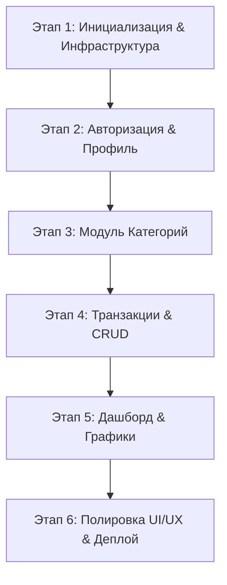

# PRD & SPEC: Веб-приложение «Salary» (Учёт доходов и расходов)

**Версия:** 1.0  
**Статус:** В разработке (Draft / Specification)  
**Технологический стек:** Next.js (App Router, TypeScript), Turso (libSQL), Drizzle ORM, Tailwind CSS, shadcn/ui.

---

## 1. Обзор проекта (Project Overview)

**Salary** — это современное, быстрое и адаптивное веб-приложение для персонального и семейного учёта финансов (доходов и расходов). Приложение помогает пользователю контролировать денежные потоки, категоризировать траты и поступления, анализировать баланс и формировать наглядную статистику за различные периоды.

### Ключевые цели
1. Предоставить простой и интуитивный интерфейс для быстрого добавления транзакций (менее 5 секунд на запись).
2. Обеспечить гибкую систему категорий (доходы и расходы) с цветовой и визуальной дифференциацией.
3. Обеспечить надёжную изоляцию пользовательских данных через авторизацию.
4. Использовать современный, производительный стек с облачной распределённой базой данных Turso.

---

## 2. Архитектура и Технологический стек

| Компонент | Технология | Обоснование |
| :--- | :--- | :--- |
| **Frontend & Backend** | **Next.js (App Router)** | Единый стек (Fullstack), Server Actions для мутаций, SSR/RSC для высокой скорости загрузки. |
| **Язык разработки** | **TypeScript** | Строгая типизация моделей данных, форм и API. |
| **База данных** | **Turso (libSQL / SQLite edge)** | Сверхбыстрый отклик, бессерверный SQLite, щедрый бесплатный тариф, идеальная работа на edge/serverless. |
| **ORM / Query Builder** | **Drizzle ORM** | Нативная поддержка Turso (`@libsql/client`), типобезопасные миграции, легковесность. |
| **Стилизация и UI** | **Tailwind CSS + shadcn/ui** | Быстрая вёрстка, доступные и стильные компоненты (Radix UI primitives). |
| **Иконки** | **Lucide React** | Легковесные, чистые векторные иконки для категорий и интерфейса. |
| **Графика и Аналитика** | **Recharts** | Адаптивные графики (Donut chart для категорий, Bar chart для динамики доходов/расходов). |
| **Аутентификация** | **Auth.js (NextAuth v5) / JWT Credentials** | Безопасная аутентификация по Email/Password и опционально OAuth (Google). Сессии на основе JWT/DB. |
| **Валидация данных** | **Zod + React Hook Form** | Единые схемы валидации на клиенте и сервере. |

---

## 3. Функциональные требования (Functional Requirements)

### 3.1. Аутентификация и пользователи
- Регистрация по Email и паролю (хеширование паролей через `bcrypt` / `argon2`).
- Вход в систему и завершение сессии (Logout).
- Защита маршрутов: неавторизованные пользователи перенаправляются на `/login`.
- Изоляция данных: каждый пользователь имеет доступ исключительно к своим категориям и транзакциям (`user_id` во всех таблицах).
- Профиль пользователя: выбор базовой валюты (например: UZS, USD, RUB, EUR), смена имени/пароля.

### 3.2. Управление категориями (Categories)
Категории разделены на два типа: **`EXPENSE` (Расход)** и **`INCOME` (Доход)**.

- **Предустановленные (Default) категории при регистрации:**
  - *Доходы:* Зарплата (Salary), Фриланс / Подработка, Инвестиции, Подарки, Прочее.
  - *Расходы:* Продукты и супермаркеты, Кафе и рестораны, Жильё и коммуналка, Транспорт и авто, Здоровье и аптеки, Развлечения и отдых, Покупки и одежда, Образование, Другое.
- **Пользовательские действия:**
  - Создание новой категории: название, тип (`INCOME` / `EXPENSE`), выбор иконки (из библиотеки Lucide), выбор цвета (Color picker / палитра).
  - Редактирование названия, цвета и иконки.
  - Удаление или архивация категории (с проверкой наличия связанных транзакций).

### 3.3. Учёт транзакций (Transactions)
- **Создание транзакции:**
  - Тип: Доход / Расход.
  - Сумма (числовое поле с валидацией > 0).
  - Категория (выпадающий список с иконками и поиском).
  - Дата и время (по умолчанию текущая дата, возможность выбора задним числом).
  - Комментарий / Описание (опционально).
  - Способ оплаты (Наличные, Карта, Банковский счёт — опционально).
- **Список транзакций:**
  - Хронологическая лента (группировка по дням/месяцам).
  - Фильтры: по диапазону дат, по типу (доход/расход), по категориям, поиск по комментарию.
  - Пагинация или Infinite Scroll.
  - Быстрое редактирование и удаление записи.

### 3.4. Дашборд и Главный экран (Dashboard)
- **Концепция компактного Hero-виджета (в соответствии с [Design.md](file:///d:/Saidamir/Design.md)):**
  - Центральный блок с текущим балансом в формате `$ USD` (акцентный моноширинный шрифт).
  - Быстрая плавающая / центральная кнопка «+ Добавить запись».
  - Компактные индикаторы за текущий месяц: «Доходы: +$X,XXX» и «Расходы: -$X,XXX».
- **Лента последних транзакций:**
  - 5 последних операций в виде интерактивных карточек со скруглёнными углами (`rounded-2xl`) и полупрозрачным эффектом стекла (Glassmorphism).
- **Срез по категориям:**
  - Наглядный топ расходов за месяц с прогресс-барами.
- **Страница аналитики:**
  - Детальные диаграммы (Donut chart распределения расходов и Bar chart динамики доходов/расходов).

### 3.5. Дополнительные возможности (Фаза 2)
- Экспорт истории транзакций в CSV / Excel.
- Лимиты/Бюджеты на категории (индикатор % исчерпания бюджета).
- Поддержка мультивалютности с автоматической конвертацией.

---

## 4. Схема базы данных (Turso / SQLite Schema via Drizzle)

```sql
-- Таблица пользователей
CREATE TABLE users (
  id TEXT PRIMARY KEY,               -- cuid2 / uuid v4
  email TEXT UNIQUE NOT NULL,
  password_hash TEXT NOT NULL,
  name TEXT,
  currency TEXT DEFAULT 'USD' NOT NULL, -- USD, UZS, RUB, etc.
  created_at INTEGER NOT NULL,       -- Unix timestamp (ms)
  updated_at INTEGER NOT NULL
);

-- Таблица сессий (при необходимости database-based sessions)
CREATE TABLE sessions (
  id TEXT PRIMARY KEY,
  user_id TEXT NOT NULL REFERENCES users(id) ON DELETE CASCADE,
  expires_at INTEGER NOT NULL
);

-- Таблица категорий
CREATE TABLE categories (
  id TEXT PRIMARY KEY,
  user_id TEXT NOT NULL REFERENCES users(id) ON DELETE CASCADE,
  name TEXT NOT NULL,
  type TEXT NOT NULL CHECK (type IN ('INCOME', 'EXPENSE')),
  icon TEXT NOT NULL DEFAULT 'circle-dollar-sign',
  color TEXT NOT NULL DEFAULT '#6366f1',
  is_default INTEGER DEFAULT 0 NOT NULL,
  created_at INTEGER NOT NULL
);

-- Таблица транзакций
CREATE TABLE transactions (
  id TEXT PRIMARY KEY,
  user_id TEXT NOT NULL REFERENCES users(id) ON DELETE CASCADE,
  category_id TEXT NOT NULL REFERENCES categories(id) ON DELETE RESTRICT,
  type TEXT NOT NULL CHECK (type IN ('INCOME', 'EXPENSE')),
  amount REAL NOT NULL,              -- денежная сумма (FLOAT/REAL)
  date INTEGER NOT NULL,             -- дата транзакции (Unix timestamp)
  description TEXT,
  payment_method TEXT DEFAULT 'CARD',-- CASH, CARD, TRANSFER
  created_at INTEGER NOT NULL,
  updated_at INTEGER NOT NULL
);

-- Индексы для ускорения выборок
CREATE INDEX idx_transactions_user_date ON transactions(user_id, date DESC);
CREATE INDEX idx_transactions_category ON transactions(category_id);
CREATE INDEX idx_categories_user_type ON categories(user_id, type);
```

---

## 5. План реализации по этапам (Roadmap)



### Этап 1: Инициализация проекта и БД
- Создание проекта Next.js (App Router, Tailwind CSS, TypeScript).
- Настройка подключения к Turso Database (`@libsql/client` + `drizzle-orm`).
- Настройка миграций через `drizzle-kit`.
- Создание базового Layout, темы, шрифтов и shadcn/ui компонентов.

### Этап 2: Аутентификация
- Реализация моделей `users` и `sessions`.
- Формы `/register` и `/login` с клиентской и серверной валидацией (Zod).
- Middleware для защиты приватных страниц (`/dashboard`, `/transactions`, `/categories`, `/settings`).
- Генерация дефолтных категорий при успешной регистрации нового пользователя.

### Этап 3: Управление категориями
- API / Server Actions: `getCategories`, `createCategory`, `updateCategory`, `deleteCategory`.
- Страница `/categories`: переключение между вкладками «Доходы» и «Расходы».
- Модальное окно создания/редактирования категории с выбором цвета и иконки.

### Этап 4: Учёт транзакций
- Server Actions: `getTransactions`, `addTransaction`, `editTransaction`, `deleteTransaction`.
- Быстрая модальная форма добавления транзакции с валидацией.
- Страница `/transactions`: таблица / карточный список транзакций с фильтрами по дате, типу, категориям и поиском.

### Этап 5: Главная страница (Дашборд) и Аналитика
- Сводные карточки: Баланс, Доход за месяц, Расход за месяц.
- Диаграммы Recharts: круговая диаграмма расходов по категориям, столбчатый график динамики.
- Список последних операций.
- Переключатель периодов: Сегодня / Текущая неделя / Текущий месяц / Пользовательский период.

### Этап 6: Дизайн, Тестирование и Релиз
- Интеграция дизайн-системы из `Design.md`.
- Адаптация под мобильные устройства (PWA-ready / Mobile Bottom Navigation).
- Тестирование граничных случаев (нулевой баланс, большие числа, удаление категорий).
- Деплой на Vercel с подключением production-базы Turso.

---

## 6. Нефункциональные требования
- **Скорость отклика:** Время ответа страниц и действий < 200 мс за счёт размещения Turso в ближайшем регионе и легковесного RSC.
- **Безопасность:** HTTPS, CSRF-защита, хеширование паролей, защищённые HTTP-only cookies.
- **Адаптивность:** Полная поддержка экранов от 360px до 4K мониторов (Mobile First).
- **Локализация:** Поддержка чисел и денежных форматов в зависимости от валюты.
